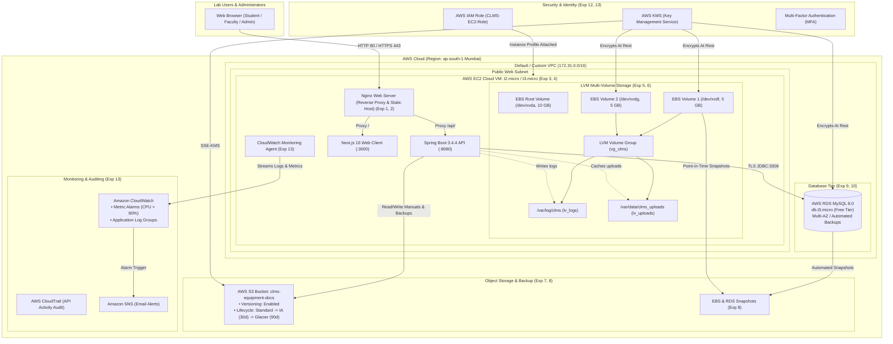

# AWS Cloud Deployment & Architecture Guide: CLMS Mini Project
**Course:** Professional Skills II (Generic Track: Cloud Infrastructure-I)  
**Course Code:** HME-COMP-PS301 | **Class:** S.E. Semester-III (Computer Engineering)  
**Framework:** CBCGS-HME 2023 (TCET Autonomous)  
**Project:** CLMS (College Laboratory Management System)  
**Repository:** [IP_CLMS](https://github.com/ShreyashGitHubb/IP_CLMS)

---

## 1. Executive Summary & Project Analysis

The **CLMS (College Laboratory Management System)** repository is a full-stack, enterprise-grade web application built to streamline laboratory inventory, equipment tracking, student loan requests, and administrative operations.

### Current Codebase Anatomy:
- **Frontend Layer:** Next.js 16 (App Router), React 19, TypeScript, Tailwind CSS v4, Lucide Icons.
- **Backend Service Layer:** Spring Boot 3.4.4, Java 17, Spring Data JPA, Hibernate, JWT Bearer Token Security.
- **Database & Persistence:** Relational schema supporting MySQL 8.0, PostgreSQL, and H2; automated Flyway schema migrations (`V1` through `V7`).
- **Core Entities:** `User` (Admin/Member roles), `Equipment` (Lab inventory, asset tags, categories, availability), `EquipmentRequest` (Student borrowing approval workflow), `EquipmentTransaction` (Check-in/Check-out audit logs).

### Why CLMS is the Perfect Capstone for AWS Cloud Infrastructure-I:
Unlike trivial static HTML/JS websites, CLMS represents a **real-world three-tier enterprise workload**:
1. **Presentation Tier:** Interactive Next.js single-page dashboard.
2. **Application Tier:** Stateless REST API services handling authentication, business validation, and audit tracking.
3. **Database Tier:** ACID-compliant relational database storing laboratory inventory and transaction histories.
4. **Unstructured File Storage Tier:** Equipment manuals (PDFs), lab safety datasheets, calibration certificates, and backup snapshots.

---

## 2. Syllabus Mapping Matrix: Experiments 1–14 mapped to CLMS (Exp 15)

This matrix establishes how **every single experiment from the TCET syllabus** is actively utilized and demonstrated in the final CLMS Mini Project deployment on AWS:

| Exp No. | Syllabus Experiment Topic | Relevant COs | Implementation in CLMS Mini Project | AWS Resources Used |
|---|---|---|---|---|
| **Exp 1** | Design & deploy static web app on web server | CO1 (L1-L6) | Build Next.js production web bundle and serve through high-performance Nginx web server. | Nginx, Linux |
| **Exp 2** | Design & deploy static web app on web server VM | CO1, CO2 | Host Next.js web application on an isolated Linux Virtual Machine. | Virtual Machine, Nginx |
| **Exp 3** | Cloud account setup & Cloud VM deployment via SSH/RDP | CO1, CO2 | Provision AWS EC2 instance (Ubuntu 22.04 LTS), configure VPC Security Groups, and connect via SSH key pair (`clms-key.pem`). | AWS EC2, Security Groups, Key Pairs |
| **Exp 4** | Deploy static web application on Cloud VM | CO1, CO2 | Deploy and serve the compiled CLMS client on the AWS EC2 instance with HTTP/HTTPS listeners. | EC2, Nginx, Systemd |
| **Exp 5** | Implement Logical Volume Manager (LVM) | CO5 (L1-L6) | Initialize Physical Volumes (PV), Volume Group (`vg_clms`), and Logical Volumes (`lv_logs`, `lv_uploads`) to prevent root filesystem exhaustion. | Linux LVM (`pvcreate`, `vgcreate`, `lvcreate`) |
| **Exp 6** | Launch Cloud VM with Multiple Volumes & analyze | CO6 (L1-L6) | Attach two independent Elastic Block Store (EBS) gp3 volumes (5 GB each) to the EC2 VM; benchmark I/O and demonstrate dynamic volume extension (`lvextend`). | AWS EBS (gp3 volumes), EC2 Block Device Mapping |
| **Exp 7** | Object storage, lifecycle policies & versioning | CO2 (L1-L6) | Provision S3 Bucket (`clms-equipment-docs`) to store equipment manuals, photos, and backups; configure S3 Bucket Versioning and Lifecycle transition rules (Standard -> IA -> Glacier). | AWS S3, Bucket Versioning, Lifecycle Rules |
| **Exp 8** | Data backup and recovery strategies | CO2 (L1-L6) | Create EBS Snapshots and automated RDS MySQL snapshots; deploy a cron-based `mysqldump` script backing up to S3; demonstrate disaster recovery restoration drill. | AWS EBS Snapshots, RDS Automated Backups, S3 Backups |
| **Exp 9** | Cloud Relational Database & CRUD operations | CO2, CO4 | Deploy AWS RDS MySQL instance; run Spring Boot Flyway migrations (`V1`-`V7`); execute CRUD operations for lab equipment and member transactions. | AWS RDS MySQL 8.0, Spring Data JPA, Flyway |
| **Exp 10** | Local web app connected to Cloud Database | CO1, CO4 | Connect the student's local laptop Spring Boot/Next.js environment to the cloud-hosted AWS RDS MySQL database via secure database endpoint. | AWS RDS, Security Group Ingress Rules |
| **Exp 11** | Cloud development tools & automation (AWS CLI) | CO3, CO4 | Write and execute reusable bash automation scripts using AWS CLI v2 to provision EC2, EBS, S3, and Security Groups in a single command. | AWS CLI v2, Bash Scripts / CloudFormation |
| **Exp 12** | IAM roles, users, permissions & MFA | CO1, CO4 | Create dedicated IAM user with Multi-Factor Authentication (MFA); create EC2 IAM Instance Profile Role (`CLMS-EC2-Role`) for credential-free S3 access. | AWS IAM, Virtual MFA, Instance Profiles |
| **Exp 13** | Encryption at rest & transit, logging & monitoring | CO2, CO4 | Enable AWS KMS encryption for EBS and RDS storage; enforce TLS/SSL for MySQL and HTTPS web traffic; install CloudWatch Agent for CPU/memory/log streaming and alarm alerts. | AWS KMS, AWS CloudWatch, CloudTrail, SSL/TLS |
| **Exp 14** | Case study on cloud computing services | CO1-CO4 | Comparative analysis of IaaS (EC2/EBS), PaaS (Elastic Beanstalk/RDS), and Serverless (Lambda/S3/DynamoDB) for laboratory management systems. | Cloud Architecture Comparative Study |
| **Exp 15** | **Mini Project (Final Capstone Integration)** | **CO1-CO6** | **End-to-End unified CLMS cloud deployment integrating all experiments into a cohesive production architecture.** | **Full AWS Cloud Stack** |

---

## 3. High-Level Architecture Diagram



---

## 4. Step-by-Step Implementation Guide

### Phase 1: Security, Identity & IAM Setup (Exp 12, Exp 13)

1. **Enable Multi-Factor Authentication (MFA) on AWS Root Account:**
   - Log into AWS Console -> IAM Dashboard -> Security Credentials -> Assign MFA device (Google Authenticator / Authy).
2. **Create IAM Admin User for Lab Operations:**
   - User Name: `clms-admin`
   - Attach Policy: `AdministratorAccess` (or custom scoped policies `AmazonEC2FullAccess`, `AmazonRDSFullAccess`, `AmazonS3FullAccess`).
   - Enable console access and generate access keys.
3. **Create EC2 IAM Instance Profile Role (`CLMS-EC2-Role`):**
   - Trust Relationship: `ec2.amazonaws.com`
   - Attached Policies:
     - `AmazonS3FullAccess` (allows EC2 to push/pull from S3 without hardcoded API keys)
     - `CloudWatchAgentServerPolicy` (allows EC2 to stream system metrics and logs)

```bash
# Phase 1: Create IAM Role via AWS CLI
aws iam create-role --role-name CLMS-EC2-Role \
  --assume-role-policy-document '{
    "Version": "2012-10-17",
    "Statement": [{"Effect": "Allow", "Principal": {"Service": "ec2.amazonaws.com"}, "Action": "sts:AssumeRole"}]
  }'

aws iam attach-role-policy --role-name CLMS-EC2-Role --policy-arn arn:aws:iam::aws:policy/AmazonS3FullAccess
aws iam attach-role-policy --role-name CLMS-EC2-Role --policy-arn arn:aws:iam::aws:policy/CloudWatchAgentServerPolicy
aws iam create-instance-profile --instance-profile-name CLMS-EC2-Profile
aws iam add-role-to-instance-profile --instance-profile-name CLMS-EC2-Profile --role-name CLMS-EC2-Role
```

---

### Phase 2: Compute & Security Groups Provisioning (Exp 3, Exp 11)

1. **Configure Security Groups:**
   - `clms-ec2-sg`:
     - Inbound: Port 22 (SSH - Student IP), Port 80 (HTTP - 0.0.0.0/0), Port 443 (HTTPS - 0.0.0.0/0), Port 8080 (Spring Boot - 0.0.0.0/0 or local Nginx), Port 3000 (Next.js dev).
   - `clms-rds-sg`:
     - Inbound: Port 3306 (MySQL - Source: `clms-ec2-sg` Security Group ID, plus Student Local IP for Exp 10).

```bash
# Create Security Group for EC2
VPC_ID=$(aws ec2 describe-vpcs --filters "Name=isDefault,Values=true" --query "Vpcs[0].VpcId" --output text)

EC2_SG_ID=$(aws ec2 create-security-group \
  --group-name clms-ec2-sg \
  --description "Security group for CLMS EC2 web instance" \
  --vpc-id $VPC_ID \
  --query 'GroupId' --output text)

# Authorize ports 22, 80, 443, 8080
aws ec2 authorize-security-group-ingress --group-id $EC2_SG_ID --protocol tcp --port 22 --cidr 0.0.0.0/0
aws ec2 authorize-security-group-ingress --group-id $EC2_SG_ID --protocol tcp --port 80 --cidr 0.0.0.0/0
aws ec2 authorize-security-group-ingress --group-id $EC2_SG_ID --protocol tcp --port 443 --cidr 0.0.0.0/0
aws ec2 authorize-security-group-ingress --group-id $EC2_SG_ID --protocol tcp --port 8080 --cidr 0.0.0.0/0

# Create Key Pair for SSH
aws ec2 create-key-pair --key-name clms-key --query 'KeyMaterial' --output text > clms-key.pem
chmod 400 clms-key.pem
```

2. **Launch EC2 Instance:**
   - AMI: Ubuntu Server 22.04 LTS (HVM), SSD Volume Type
   - Instance Type: `t2.micro` or `t3.micro` (Free-Tier eligible)
   - Attach IAM Instance Profile: `CLMS-EC2-Profile`

---

### Phase 3: Multiple EBS Volumes & LVM Implementation (Exp 5, Exp 6)

In production cloud environments, unmanaged log files or file uploads can fill the root disk (`/dev/xvda1`), crashing the entire operating system and database. Using **Logical Volume Manager (LVM)** over multiple AWS EBS volumes provides dynamic, zero-downtime storage scalability.

1. **Create and Attach Two EBS gp3 Volumes (5 GiB each):**

```bash
# Get the Availability Zone of the running EC2 instance
INSTANCE_AZ=$(aws ec2 describe-instances --instance-ids $INSTANCE_ID --query "Reservations[0].Instances[0].Placement.AvailabilityZone" --output text)

# Create 2 x 5GB gp3 EBS Volumes with KMS Encryption (Exp 6, Exp 13)
VOL1_ID=$(aws ec2 create-volume --availability-zone $INSTANCE_AZ --size 5 --volume-type gp3 --encrypted --tag-specifications 'ResourceType=volume,Tags=[{Key=Name,Value=CLMS-Data-Vol1}]' --query 'VolumeId' --output text)
VOL2_ID=$(aws ec2 create-volume --availability-zone $INSTANCE_AZ --size 5 --volume-type gp3 --encrypted --tag-specifications 'ResourceType=volume,Tags=[{Key=Name,Value=CLMS-Data-Vol2}]' --query 'VolumeId' --output text)

# Attach both volumes to the EC2 instance
aws ec2 attach-volume --volume-id $VOL1_ID --instance-id $INSTANCE_ID --device /dev/sdf
aws ec2 attach-volume --volume-id $VOL2_ID --instance-id $INSTANCE_ID --device /dev/sdg
```

2. **Configure LVM Inside the Linux EC2 VM (SSH into instance):**

```bash
# 1. Verify attached block devices
lsblk

# 2. Create Physical Volumes (PVs)
sudo pvcreate /dev/xvdf /dev/xvdg

# 3. Create Volume Group (VG) named 'vg_clms' combining both 5GB disks (10GB total capacity)
sudo vgcreate vg_clms /dev/xvdf /dev/xvdg
sudo vgs
sudo vgdisplay

# 4. Create Logical Volumes (LVs)
# lv_logs: 4GB dedicated for application and server logs
sudo lvcreate -L 4G -n lv_logs vg_clms
# lv_uploads: 4GB dedicated for equipment documents and file cache
sudo lvcreate -L 4G -n lv_uploads vg_clms
sudo lvs

# 5. Format Logical Volumes with ext4 filesystem
sudo mkfs.ext4 /dev/vg_clms/lv_logs
sudo mkfs.ext4 /dev/vg_clms/lv_uploads

# 6. Create mount points and mount volumes
sudo mkdir -p /var/log/clms
sudo mkdir -p /var/data/clms_uploads
sudo mount /dev/vg_clms/lv_logs /var/log/clms
sudo mount /dev/vg_clms/lv_uploads /var/data/clms_uploads

# 7. Configure persistent mounting across reboots in /etc/fstab
echo "/dev/vg_clms/lv_logs    /var/log/clms          ext4    defaults,nofail 0 2" | sudo tee -a /etc/fstab
echo "/dev/vg_clms/lv_uploads /var/data/clms_uploads   ext4    defaults,nofail 0 2" | sudo tee -a /etc/fstab

# 8. Check filesystem status
df -h /var/log/clms /var/data/clms_uploads
```

3. **Demonstrate Dynamic Volume Expansion (Live LVM Resize without downtime!):**
```bash
# Extend lv_logs by 1GB using remaining free PE in the Volume Group
sudo lvextend -L +1G /dev/vg_clms/lv_logs
# Resize the ext4 filesystem online
sudo resize2fs /dev/vg_clms/lv_logs
df -h /var/log/clms
```

---

### Phase 4: Cloud Relational Database (AWS RDS MySQL) & CRUD Verification (Exp 9, Exp 10)

1. **Provision AWS RDS MySQL Instance:**
   - Engine: MySQL 8.0.35+
   - Template: Free Tier (`db.t3.micro` or `db.t4g.micro`, 20 GiB gp2/gp3 storage)
   - DB Instance Identifier: `clms-mysql-db`
   - Master Username: `clmsadmin`
   - Master Password: `[SecurePassword123!]`
   - Storage Encryption: Enabled (AWS KMS default key)
   - VPC Security Group: `clms-rds-sg` (allows port 3306 inbound from `clms-ec2-sg`)

```bash
# Provision RDS MySQL via AWS CLI (Exp 11)
aws rds create-db-instance \
  --db-instance-identifier clms-mysql-db \
  --db-instance-class db.t3.micro \
  --engine mysql \
  --allocated-storage 20 \
  --master-username clmsadmin \
  --master-user-password "ClmsAdminPass2026!" \
  --backup-retention-period 7 \
  --storage-encrypted \
  --vpc-security-group-ids $RDS_SG_ID
```

2. **Connect CLMS Spring Boot Backend to AWS RDS (Exp 9):**
Set environment variables on the EC2 instance or in `systemd`:
```bash
export SPRING_PROFILES_ACTIVE=mysql
export DB_HOST="clms-mysql-db.cxxxxxxx.ap-south-1.rds.amazonaws.com"
export DB_PORT="3306"
export DB_NAME="clms_db"
export DB_USERNAME="clmsadmin"
export DB_PASSWORD="ClmsAdminPass2026!"
export AUTH_TOKEN_SECRET="a-very-long-32-byte-secure-jwt-secret-key-12345"
export PORT="8080"
export SEED_ADMIN="true"
export ADMIN_EMAIL="admin@clms.local"
export ADMIN_PASSWORD="Admin@123"
```
When Spring Boot starts, Flyway migrations (`V1__create_schema.sql` through `V7`) automatically execute, creating the relational schema directly on the AWS RDS instance!

3. **Demonstrate Local App Connected to Cloud Database (Exp 10):**
   - On the student's laptop, add the student's current public IP to `clms-rds-sg` on port 3306.
   - Run the local backend pointing `DB_HOST` to the RDS endpoint.
   - Perform CRUD operations locally (create equipment record, view in MySQL Workbench / DBeaver, verify data persisted in AWS RDS).

---

### Phase 5: Object Storage (AWS S3) with Versioning & Lifecycle Rules (Exp 7)

CLMS handles laboratory equipment datasheets, calibration manuals, lab safety guidelines, and automated database backup archives.

1. **Create S3 Bucket:**
```bash
BUCKET_NAME="clms-equipment-docs-shreyash"
aws s3api create-bucket --bucket $BUCKET_NAME --region ap-south-1 --create-bucket-configuration LocationConstraint=ap-south-1

# Enable Server-Side Encryption (Exp 13)
aws s3api put-bucket-encryption --bucket $BUCKET_NAME \
  --server-side-encryption-configuration '{
    "Rules": [{"ApplyServerSideEncryptionByDefault": {"SSEAlgorithm": "AES256"}}]
  }'

# Enable Bucket Versioning (Exp 7)
aws s3api put-bucket-versioning --bucket $BUCKET_NAME \
  --versioning-configuration Status=Enabled
```

2. **Configure S3 Lifecycle Transition Policies (Exp 7):**
   - Move objects older than 30 days to **S3 Standard-Infrequent Access (IA)**.
   - Archive objects older than 90 days to **S3 Glacier Flexible Retrieval**.
   - Permanently expire noncurrent object versions older than 180 days.

```bash
cat << 'EOF' > lifecycle.json
{
  "Rules": [
    {
      "ID": "CLMS-Docs-Archive-Policy",
      "Status": "Enabled",
      "Filter": {"Prefix": ""},
      "Transitions": [
        {
          "Days": 30,
          "StorageClass": "STANDARD_IA"
        },
        {
          "Days": 90,
          "StorageClass": "GLACIER"
        }
      ],
      "NoncurrentVersionExpiration": {
        "NoncurrentDays": 180
      }
    }
  ]
}
EOF

aws s3api put-bucket-lifecycle-configuration --bucket $BUCKET_NAME --lifecycle-configuration file://lifecycle.json
```

---

### Phase 6: Backup, Disaster Recovery & Automation (Exp 8, Exp 11)

1. **Automated Database Backup to S3 via Cron:**
Create `/usr/local/bin/clms-backup.sh`:
```bash
#!/bin/bash
TIMESTAMP=$(date +"%Y%m%d_%H%M%S")
BACKUP_DIR="/var/data/clms_uploads/backups"
BACKUP_FILE="${BACKUP_DIR}/clms_db_${TIMESTAMP}.sql.gz"
S3_BUCKET="s3://clms-equipment-docs-shreyash/backups"

mkdir -p $BACKUP_DIR

# Dump and compress database
mysqldump -h $DB_HOST -u $DB_USERNAME -p$DB_PASSWORD --single-transaction --routines --triggers clms_db | gzip > $BACKUP_FILE

# Upload encrypted backup to S3 using EC2 IAM Role (No keys needed!)
aws s3 cp $BACKUP_FILE ${S3_BUCKET}/

# Retain only last 7 days locally
find $BACKUP_DIR -type f -name "*.sql.gz" -mtime +7 -delete

echo "CLMS Database Backup completed and uploaded to S3: ${BACKUP_FILE}"
```
Schedule in root crontab (`crontab -e`):
```cron
0 2 * * * /usr/local/bin/clms-backup.sh >> /var/log/clms/backup.log 2>&1
```

2. **EBS Snapshot & AMI Creation (Compute Disaster Recovery):**
```bash
# Create point-in-time snapshot of the LVM volumes and root volume
aws ec2 create-snapshot --volume-id $VOL1_ID --description "CLMS Volume 1 Pre-Deployment Snapshot"
aws ec2 create-snapshot --volume-id $VOL2_ID --description "CLMS Volume 2 Pre-Deployment Snapshot"

# Create Golden Image (AMI) of the configured EC2 instance
aws ec2 create-image --instance-id $INSTANCE_ID --name "CLMS-Production-Golden-AMI" --no-reboot
```

---

### Phase 7: Web Server Setup, Reverse Proxy & Static Deployment (Exp 1, Exp 2, Exp 4)

1. **Build Next.js Frontend for Production:**
```bash
cd /home/ubuntu/IP_CLMS
pnpm install
export NEXT_PUBLIC_API_URL="/api"
pnpm run build
```

2. **Configure Nginx as Unified Reverse Proxy on EC2:**
`/etc/nginx/sites-available/clms`:
```nginx
server {
    listen 80;
    server_name _;

    # Access and Error Logs redirected to LVM Log Volume (Exp 5, 6)
    access_log /var/log/clms/nginx_access.log;
    error_log  /var/log/clms/nginx_error.log;

    # Gzip Compression for Fast Static Delivery (Exp 1, 4)
    gzip on;
    gzip_types text/plain text/css application/json application/javascript text/xml application/xml;

    # Forward REST API calls to Spring Boot backend
    location /api/ {
        proxy_pass http://127.0.0.1:8080/api/;
        proxy_set_header Host $host;
        proxy_set_header X-Real-IP $remote_addr;
        proxy_set_header X-Forwarded-For $proxy_add_x_forwarded_for;
        proxy_set_header X-Forwarded-Proto $scheme;
    }

    # Serve Next.js Frontend Application
    location / {
        proxy_pass http://127.0.0.1:3000;
        proxy_http_version 1.1;
        proxy_set_header Upgrade $http_upgrade;
        proxy_set_header Connection 'upgrade';
        proxy_set_header Host $host;
        proxy_cache_bypass $http_upgrade;
    }
}
```

3. **Systemd Services for Zero-Downtime Daemon Process Management:**
- `/etc/systemd/system/clms-backend.service`: Runs `java -jar app.jar` logging to `/var/log/clms/backend.log`.
- `/etc/systemd/system/clms-frontend.service`: Runs `pnpm start` logging to `/var/log/clms/frontend.log`.

---

### Phase 8: CloudWatch Monitoring, Alarms & Security Logging (Exp 13)

1. **Install and Configure Amazon CloudWatch Agent on EC2:**
Configure CloudWatch to monitor:
- Memory utilization percentage (not captured by standard hypervisor metrics)
- Disk space utilization of `/var/log/clms` and `/var/data/clms_uploads`
- Real-time application log streaming from `/var/log/clms/backend.log` and `/var/log/clms/nginx_access.log`

2. **Create CloudWatch Metric Alarm for CPU Utilization (>80%):**
```bash
aws cloudwatch put-metric-alarm \
  --alarm-name "CLMS-High-CPU-Utilization" \
  --metric-name CPUUtilization \
  --namespace AWS/EC2 \
  --statistic Average \
  --period 300 \
  --threshold 80 \
  --comparison-operator GreaterThanOrEqualToThreshold \
  --dimensions Name=InstanceId,Value=$INSTANCE_ID \
  --evaluation-periods 2 \
  --alarm-actions arn:aws:sns:ap-south-1:123456789012:CLMS-Alerts
```

3. **Enable AWS CloudTrail:**
Enable CloudTrail to log all AWS API management calls, tracking IAM sign-ins, security group rule edits, and unauthorized access attempts.

---

## 5. Case Study: Cloud Architecture Comparison for CLMS (Exp 14)

As required by **Experiment 14**, this case study evaluates three cloud deployment architectures for the College Laboratory Management System:

| Architectural Dimensions | Model A: IaaS (Chosen Architecture: EC2 + LVM + RDS) | Model B: PaaS (AWS Elastic Beanstalk + RDS) | Model C: Serverless (AWS Lambda + S3 + DynamoDB) |
|---|---|---|---|
| **Underlying Technologies** | EC2 VM, EBS GP3, LVM, Nginx, RDS MySQL | Elastic Beanstalk container environment, RDS | S3 Static Site, API Gateway, AWS Lambda, DynamoDB |
| **Control & Customization** | **Full control** over OS, kernel, storage partitioning (LVM), and JVM tuning. | Moderate; platform handles OS updates and capacity. | Low; constrained by serverless execution limits and runtime environments. |
| **Academic Alignment** | **100% Match:** Demonstrates LVM, multi-volume block storage, SSH, Nginx, and systemd. | High level; abstracts away block device mapping and LVM. | Bypasses traditional VM, LVM, and block volume management. |
| **Data Consistency & Schema** | High (Relational ACID with JPA/Hibernate & Flyway migrations). | High (Relational ACID). | Eventual consistency; requires NoSQL data modeling rewrite. |
| **Cost & Free Tier** | **100% Free Tier Eligible** (750 hrs t2.micro, 30GB EBS, 750 hrs db.t3.micro). | Free tier eligible, but management overhead for orchestration. | Highly cost-effective at low idle traffic, but cold-start latency for Java. |

---

## 6. Examiner Viva Preparation & Key Questions

During your term-work presentation and practical evaluation (15 marks presentation, 25 marks term work), be ready for these questions:

1. **Q: Why did you implement LVM instead of keeping everything on the EC2 root volume?**  
   *Answer:* In production Linux environments, root volume exhaustion crashes the OS. By using LVM across two EBS volumes, we separated the OS from high-churn log files (`/var/log/clms`) and user uploads (`/var/data/clms_uploads`). Furthermore, LVM allows online, zero-downtime storage expansion using `lvextend` without unmounting the filesystems or stopping the EC2 instance.

2. **Q: How does your Spring Boot backend communicate with AWS S3 without hardcoded access keys?**  
   *Answer:* We followed AWS Security Best Practices (Exp 12) by creating an **IAM Instance Profile Role** (`CLMS-EC2-Role`) and attaching it directly to the EC2 instance. The AWS SDK and AWS CLI automatically retrieve temporary rotating security credentials from the instance metadata service (IMDSv2), eliminating the security risk of storing secret keys in source code.

3. **Q: How is data protected at rest and in transit in your deployment? (Exp 13)**  
   *Answer:*  
   - **At Rest:** EBS volumes are encrypted using AWS KMS (AES-256). RDS MySQL storage uses transparent encryption. S3 buckets use Server-Side Encryption (SSE-S3 / SSE-KMS).  
   - **In Transit:** Client-to-server traffic is secured via HTTPS/TLS through Nginx. The backend-to-database connection uses TLS encryption with `sslMode=REQUIRED` in the JDBC connection string.

4. **Q: How does CLMS fulfill the S3 Object Storage requirements with Versioning and Lifecycle policies? (Exp 7)**  
   *Answer:* S3 stores laboratory equipment datasheets, calibration certificates, and compressed SQL database dumps. S3 Versioning ensures that accidental deletions or document modifications preserve previous revisions. Lifecycle policies automatically transition files older than 30 days to S3 Standard-IA to cut storage costs by 40%, and to S3 Glacier after 90 days.

5. **Q: Explain your backup and disaster recovery strategy. (Exp 8)**  
   *Answer:* We have a 3-pillar recovery strategy:  
   1. **RDS Automated Daily Snapshots & Point-in-Time Recovery (PITR)** up to 5 minutes.  
   2. **Automated nightly `mysqldump` script** compressed and pushed to our versioned S3 bucket via cron.  
   3. **EBS Snapshots and Golden AMI** for rapid EC2 instance recreation in the event of an Availability Zone outage.

---

## 7. Automated Deployment Script (`deploy-clms-aws.sh`)

A production-ready script to automate resource creation using AWS CLI (Exp 11) is provided in the repository root at [`deploy-clms-aws.sh`](./deploy-clms-aws.sh).
