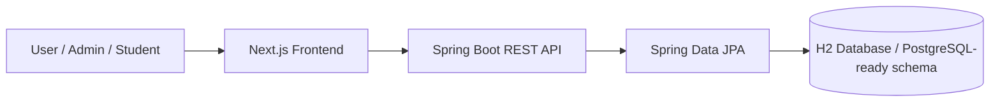

# Architecture

## 1. System overview

CLMS uses a split architecture:

- a Next.js frontend for user interaction and dashboard display
- a Spring Boot backend for API, validation, JPA entities, and service logic
- a local in-memory H2 database for development and testing



## 2. Frontend architecture

The frontend is built with the App Router model in Next.js and uses a single-page dashboard shell with route-driven content.

### Frontend responsibilities
- route navigation between dashboard, inventory, requests, transactions, maintenance, students, calendar, reports, settings
- UI composition and local state management
- data presentation and summary cards
- experience for creating or updating equipment records in modal flows

### Frontend structure

```text
app/
  page.tsx                 # main dashboard and route dispatcher
  [...slug]/page.tsx       # dynamic route fallback pattern
components/
  ui/                      # shared UI primitives
lib/
  utils.ts                 # helper utilities
```

## 3. Backend architecture

The backend follows a Spring Boot layered structure using controllers, services, entities, and repositories.

### Core packages

```text
backend/src/main/java/com/metropolis/lab/
├── common/
│   ├── ApiExceptionHandler.java
│   └── ResourceNotFoundException.java
├── equipment/
│   ├── Equipment.java
│   ├── EquipmentController.java
│   ├── EquipmentRepository.java
│   ├── EquipmentService.java
│   └── EquipmentStatus.java
├── health/
│   └── HealthController.java
├── log/
│   └── AuditLog.java
├── transaction/
│   ├── Transaction.java
│   └── TransactionController.java
├── user/
│   ├── User.java
│   ├── UserController.java
│   └── UserRepository.java
├── LabEquipmentApplication.java
└── ...
```

### Backend responsibilities
- receive HTTP requests from the frontend
- validate incoming payloads
- execute domain logic in service classes
- persist and query JPA entities via repositories
- return structured API responses with clear error handling

## 4. Data model

### Users
- id
- name
- email
- password hash
- role
- createdAt

### Equipment
- id
- name
- category
- assetTag
- status
- location
- description
- createdAt

### Transactions
- id
- equipmentId
- userId
- action
- dueAt
- returnedAt
- notes
- createdAt

### Logs
- id
- userId
- action
- entityType
- entityId
- details
- createdAt

## 5. API layer

### Health
- `GET /api/health`

### Equipment
- `GET /api/equipment`
- `GET /api/equipment/{id}`
- `POST /api/equipment`
- `PUT /api/equipment/{id}` — add `?closeMaintenance=true` to resolve the item's unresolved maintenance tickets in the same transaction when returning it to circulation
- `DELETE /api/equipment/{id}`

Equipment status is shared state between maintenance tickets and loans, so every writer goes through the same rules: logging a ticket moves an item to `MAINTENANCE` (retired items stay retired), returning a loan only releases the item once no ticket is unresolved, and an administrator cannot put an item back into circulation while either an active loan or an unresolved ticket exists.

### Users
- `GET /api/users`

### Transactions
- `GET /api/transactions`
- `POST /api/transactions`
- `PUT /api/transactions/{id}/return`

`POST /api/transactions` records checkouts only; returns go through `PUT /api/transactions/{id}/return` so the loan and the equipment status close together. An asset can hold only one open loan: issuing and request approval both check the transaction ledger, and checking one loan in keeps the item `IN_USE` while another loan is still open. The kiosk resolves the open loan on every scan for the same reason — a damage ticket moves an item to maintenance while it is still out, and the station must keep offering check-in.

## 5.1 Concurrency control

`TransactionService` owns the two writes that must never interleave, and reads the equipment row through `EquipmentRepository.findByIdForUpdate` (`@Lock(LockModeType.PESSIMISTIC_WRITE)`, `SELECT ... FOR UPDATE`). Request approval and cancellation lock their own request row through `EquipmentRequestRepository.findByIdForUpdate`. Locks are always taken equipment first, then the dependent row, so the flows cannot deadlock against each other.

Two details matter for correctness. A locking query never refreshes an entity that the persistence context already holds, so the service resolves the asset of a loan with a scalar projection (`findEquipmentIdById`) before locking; and every write uses `saveAndFlush`, because a flush inside the transaction is what turns a lost update into an exception the exception handler can still translate into a `409` instead of a failure after the response is written.

`Equipment` additionally carries a JPA `@Version` column (`equipment.version`), so a record changed underneath a running transaction fails with `OptimisticLockingFailureException` rather than being overwritten. `ApiExceptionHandler` maps that and any lock timeout to `409` with `"code": "CONCURRENT_UPDATE"`, which lets the frontend tell a lost race apart from a business rule conflict.

### Schema migrations

- `backend/src/main/resources/db/migration/V7__add_equipment_optimistic_lock.sql` — Flyway, runs on deploy.
- `backend/sql/V7__add_equipment_optimistic_lock.sql` — same change for a CLI or SQL-console run against a live schema, plus a read-only report of inconsistent rows.

Both are guarded with an `INFORMATION_SCHEMA` check, so applying the column by hand and then deploying does not fail Flyway. `schema.sql` and `schema-mysql.sql` carry the column for fresh databases.

## 5.2 Transactional email

`MailService` sends through the Resend HTTP API with Spring's `RestClient`, so the feature adds no Maven dependency and leaves the build untouched. It is deliberately the weakest link in the request path:

- it is inert unless `MAIL_ENABLED=true` **and** `RESEND_API_KEY` is set, which is why the existing tests need no provider;
- sends are registered as an `afterCommit` synchronization, so an aborted transaction never emails anyone and the provider call never runs while an equipment row lock is held;
- delivery runs on a small bounded thread pool, and every failure is caught and logged, so a provider outage cannot turn a successful operation into an error;
- `MailTemplates` escapes all interpolated user supplied text.

`OverdueLoanMailer` is a `@Scheduled` job (cron configurable through `MAIL_OVERDUE_CRON`) that emails members whose loan passed its due date; it returns immediately when email is disabled. In-app notifications remain in place for every one of these events.

## 6. Design principles

## 6. Design principles

- keep the frontend simple and visually strong for admin workflows
- separate controller and service responsibilities in the backend
- rely on JPA entities and repositories rather than ad-hoc DAO code
- use validation and central exception handling for stable APIs
- keep development setup lightweight and easy to run locally

## 7. Local environment strategy

The project is configured to work without a local PostgreSQL install by default. It uses H2 as a development-ready database engine while keeping the schema compatible with PostgreSQL structures as much as practical.

This is useful for:
- local team onboarding
- fast prototyping
- CI/test stability
- reducing environment blockers

## 8. Security and operations considerations

Current production readiness is limited. Recommended future improvements include:

- end-to-end authentication and authorization
- secure password hashing and session handling
- SCIM or LDAP integration for institutional identity management
- PostgreSQL production profile configuration
- environment-based secrets management
- API rate limiting and auditing

## 9. Scalability direction

The current architecture provides a clean base for growth:

- add more domain services for requests and maintenance
- introduce queue/approval workflows
- connect analytics and reporting dashboards
- migrate to a production database profile
- support multi-campus or multi-lab operations

## 10. Architectural summary

The project is intentionally designed as a pragmatic, implementation-friendly lab dashboard with clear separation between:

- user-facing admin experiences
- backend business logic
- persistent data storage

This makes it easy for a team to continue building features without reworking the system structure.
