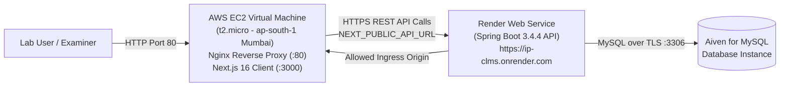

# Deploy CLMS Frontend on AWS EC2 (Replacing Vercel)

This guide documents deploying the **CLMS Next.js frontend** on an **AWS EC2 Virtual Machine** with an **Nginx reverse proxy**, while connecting to the existing production **Render backend API** and **Aiven MySQL database**.

> **Zero Code Change Guarantee:** No application source code in `app/`, `components/`, or `backend/` is modified. The transition replaces Vercel with AWS EC2 purely through infrastructure provisioning and environment variables.

---

## 1. System Architecture

The existing architecture previously hosted the Next.js frontend on Vercel. In this AWS deployment, the frontend moves to an **AWS EC2 Cloud Virtual Machine** (`t2.micro` - Free Tier) running Ubuntu 22.04 LTS and Nginx.



---

## 2. Academic Alignment: TCET S.E. Sem-III Syllabus

This deployment directly fulfills the requirements of **Professional Skills II (Generic Track: Cloud Infrastructure-I)** — Course Code: `HME-COMP-PS301`:

| Experiment No. | Syllabus Topic | How Demonstrated in CLMS Frontend Deployment |
|---|---|---|
| **Exp 1** | Static web application on web server | Nginx configured as a production web server with gzip compression and caching headers. |
| **Exp 2** | Static web application on web server VM | Hosting the frontend stack within an isolated Linux Virtual Machine. |
| **Exp 3** | Cloud VM deployment using SSH | Provisioning an AWS EC2 instance (`t2.micro`), configuring Security Groups, and accessing via SSH key (`clms-key.pem`). |
| **Exp 4** | Deploy static web application on Cloud VM | Compiling Next.js production build and running it live on the AWS EC2 instance. |
| **Exp 10** | Web application connected to cloud database/backend | Connecting the AWS-hosted frontend across clouds to the Render API and Aiven database. |
| **Exp 11** | Cloud development tools & automation (AWS CLI) | Automated provisioning script using AWS CLI v2 for one-command deployment. |
| **Exp 15** | **Mini Project (Capstone)** | **Full end-to-end integration of the CLMS application on AWS Cloud Infrastructure.** |

---

## 3. Deployment Steps on AWS

### Step 1: Configure AWS Security Group (`clms-frontend-sg`)
Create an EC2 Security Group that allows inbound web traffic:
- **SSH (Port 22):** Source: `0.0.0.0/0` (or your personal IP) for remote terminal administration.
- **HTTP (Port 80):** Source: `0.0.0.0/0` for public web browser access.

```bash
# Retrieve Default VPC
VPC_ID=$(aws ec2 describe-vpcs --filters "Name=isDefault,Values=true" --query "Vpcs[0].VpcId" --output text)

# Create Security Group
SG_ID=$(aws ec2 create-security-group \
  --group-name clms-frontend-sg \
  --description "Security group for CLMS Next.js Frontend on EC2" \
  --vpc-id $VPC_ID \
  --query 'GroupId' --output text)

# Authorize Ports 22 and 80
aws ec2 authorize-security-group-ingress --group-id $SG_ID --protocol tcp --port 22 --cidr 0.0.0.0/0
aws ec2 authorize-security-group-ingress --group-id $SG_ID --protocol tcp --port 80 --cidr 0.0.0.0/0
```

---

### Step 2: Create SSH Key Pair
Generate a private key to authenticate to the Linux VM:

```bash
aws ec2 create-key-pair --key-name clms-frontend-key --query 'KeyMaterial' --output text > clms-frontend-key.pem
chmod 400 clms-frontend-key.pem
```

---

### Step 3: Launch AWS EC2 Instance (`t2.micro` - Free Tier)
Launch an Ubuntu 22.04 LTS instance in `ap-south-1` (Mumbai):

```bash
# Resolve latest official Ubuntu 22.04 LTS AMI ID
AMI_ID=$(aws ssm get-parameter --name /aws/service/canonical/ubuntu/server/22.04/stable/current/amd64/hvm/ebs-gp2/ami-id --query "Parameter.Value" --output text)

# Launch Instance
INSTANCE_ID=$(aws ec2 run-instances \
  --image-id $AMI_ID \
  --count 1 \
  --instance-type t2.micro \
  --key-name clms-frontend-key \
  --security-group-ids $SG_ID \
  --tag-specifications 'ResourceType=instance,Tags=[{Key=Name,Value=CLMS-Frontend-EC2}]' \
  --query 'Instances[0].InstanceId' --output text)

# Wait for instance to start
aws ec2 wait instance-running --instance-ids $INSTANCE_ID

# Get Public IP
PUBLIC_IP=$(aws ec2 describe-instances --instance-ids $INSTANCE_ID --query "Reservations[0].Instances[0].PublicIpAddress" --output text)
echo "CLMS Frontend EC2 Public IP: $PUBLIC_IP"
```

---

### Step 4: Configure the EC2 Virtual Machine

SSH into the newly created instance:
```bash
ssh -i clms-frontend-key.pem ubuntu@$PUBLIC_IP
```

Inside the EC2 instance, execute the following setup:

#### 1. Setup 2GB Swap Memory (Crucial for `t2.micro`)
`t2.micro` instances have 1 GB of physical RAM. Next.js builds require ~1.5 GB. Adding a 2 GB swap prevents Out-of-Memory (OOM) compiler crashes:
```bash
sudo fallocate -l 2G /swapfile
sudo chmod 600 /swapfile
sudo mkswap /swapfile
sudo swapon /swapfile
echo '/swapfile none swap sw 0 0' | sudo tee -a /etc/fstab
```

#### 2. Install Node.js 22, pnpm, and Nginx
```bash
# Install Node.js 22 LTS
curl -fsSL https://deb.nodesource.com/setup_22.x | sudo -E bash -
sudo apt-get update
sudo apt-get install -y nodejs nginx git

# Install pnpm and PM2 process manager
sudo npm install -g pnpm pm2
```

#### 3. Clone Repository & Build Frontend
```bash
cd /home/ubuntu
git clone https://github.com/ShreyashGitHubb/IP_CLMS.git
cd IP_CLMS

# Install dependencies
pnpm install

# Build Next.js pointing to production Render backend API
export NEXT_PUBLIC_API_URL="https://ip-clms.onrender.com"
pnpm run build
```

#### 4. Run Frontend Daemon with PM2
```bash
# Start Next.js production server on port 3000
pm2 start "pnpm start" --name "clms-frontend"
pm2 startup
pm2 save
```

#### 5. Configure Nginx Reverse Proxy (Port 80 $\to$ Port 3000)
Edit `/etc/nginx/sites-available/default`:
```nginx
server {
    listen 80 default_server;
    listen [::]:80 default_server;
    server_name _;

    gzip on;
    gzip_types text/plain text/css application/json application/javascript text/xml application/xml;

    location / {
        proxy_pass http://127.0.0.1:3000;
        proxy_http_version 1.1;
        proxy_set_header Upgrade $http_upgrade;
        proxy_set_header Connection 'upgrade';
        proxy_set_header Host $host;
        proxy_set_header X-Real-IP $remote_addr;
        proxy_set_header X-Forwarded-For $proxy_add_x_forwarded_for;
        proxy_set_header X-Forwarded-Proto $scheme;
        proxy_cache_bypass $http_upgrade;
    }
}
```
Test and reload Nginx:
```bash
sudo nginx -t
sudo systemctl restart nginx
```

---

## 4. Update Render Backend CORS (`APP_ORIGINS`)

To allow your AWS-hosted frontend to communicate with your Render backend, update your CORS configuration in Render:

1. Open your [Render Dashboard](https://dashboard.render.com).
2. Select your backend service: `ip-clms`.
3. Navigate to **Environment**.
4. Locate the `APP_ORIGINS` variable.
5. Append your AWS EC2 Public IP address (`http://<YOUR-EC2-PUBLIC-IP>`) to the comma-separated list:

```text
https://ip-clms-hkkxi46o9-shreyashgithubbs-projects.vercel.app,http://localhost:3000,https://ip-clms.vercel.app,https://clms.shreyashvishwakarma.in,http://<YOUR-EC2-PUBLIC-IP>
```

6. Click **Save Changes**. Render will automatically redeploy the backend with the new allowed origin in ~1 minute.

---

## 5. Verification & Testing

Open `http://<YOUR-EC2-PUBLIC-IP>` in any browser.

### Test Checklist:
1. **Landing & UI Test:** Verify the CLMS landing page and dashboard load smoothly with Tailwind styling and Lucide icons.
2. **Authentication Test:** Navigate to `/sign-in` and sign in with the demo credentials:
   - **Administrator:** `admin@clms.local` / `Admin@123`
   - **Member:** `member@clms.local` / `Member@123`
3. **API & Database Persistence Test:**
   - Go to **Inventory** / **Equipment**.
   - Verify existing lab equipment records populate from the Aiven MySQL database through the Render API.
   - Create a new equipment item or request; verify it reflects immediately.
4. **Browser Network Inspection:**
   - Press `F12` $\to$ **Network** tab.
   - Confirm requests are issued to `https://ip-clms.onrender.com/api/...` with HTTP `200 OK` responses and zero CORS errors.

---

## 6. Cost & AWS Free Tier Analysis

This deployment is **100% Free Tier Eligible** ($0.00 cost):

| Resource | AWS Free Tier Monthly Limit | CLMS Frontend Usage | Cost Incurred |
|---|---|---|---|
| **EC2 `t2.micro`** | 750 hours / month | 1 instance running | **$0.00** |
| **EBS Storage (gp2/gp3)** | 30 GB / month | 8 GB default root volume | **$0.00** |
| **Security Groups** | Unlimited | 1 group (`clms-frontend-sg`) | **$0.00** |
| **Public IPv4** | In-bundle with running EC2 | 1 auto-assigned IP | **$0.00** |
| **Data Transfer Out** | 100 GB / month free | < 500 MB typical demo | **$0.00** |

*In addition, your AWS account holds **$119.95 USD in promotional credits** with 131 days remaining.*

---

## 7. Viva Voce & Presentation Talking Points

Use these points during your practical exam and presentation:

1. **Why did you choose AWS EC2 for the frontend instead of Vercel?**  
   *Answer:* Vercel is a managed proprietary PaaS. Deploying on AWS EC2 demonstrates IaaS (Infrastructure as a Service) fundamentals required by our syllabus: provisioning virtual machines, configuring VPC security groups, managing Linux daemon processes via PM2, and running an Nginx reverse proxy.

2. **Why was a swap file configured on the EC2 instance?**  
   *Answer:* AWS Free Tier `t2.micro` instances provide 1 GB of RAM. The Next.js 16 build process peak memory exceeds 1 GB. Allocating 2 GB of virtual swap memory on the EBS volume allowed the build process to finish successfully without triggering Linux Out-Of-Memory (OOM) killer terminations.

3. **How is cross-origin communication handled between AWS and Render?**  
   *Answer:* In our Spring Boot `CorsConfig.java`, allowed origins are dynamic via `APP_ORIGINS`. We added the AWS EC2 public origin (`http://<EC2-IP>`) to Render's environment variables, allowing authenticated JSON REST requests with Bearer tokens while protecting the API against unauthorized domains.

---

## 8. Troubleshooting

| Issue | Cause | Solution |
|---|---|---|
| `Browser shows "Site can't be reached"` | Security Group missing Port 80 | In AWS Console, check `clms-frontend-sg` and ensure Port 80 HTTP is open to `0.0.0.0/0`. |
| `CORS error in Browser Console` | EC2 Public IP not in Render `APP_ORIGINS` | Add `http://<EC2-PUBLIC-IP>` (with `http://`, no trailing slash) to Render `APP_ORIGINS` and save. |
| `Build failed: Killed` | EC2 ran out of memory | Verify swap space is enabled with `free -m`. Ensure `/swapfile` is active. |
| `Nginx shows 502 Bad Gateway` | Next.js server not running on port 3000 | Check PM2 status with `pm2 status`. Restart using `pm2 restart clms-frontend`. |
